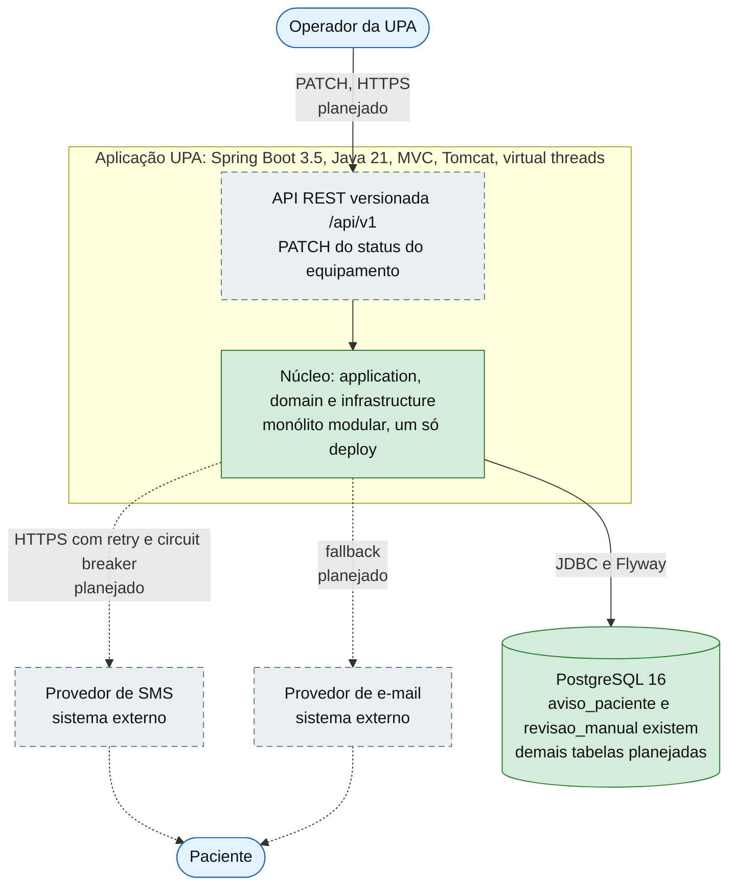

# C4: contêineres e componentes

Os diagramas usam `flowchart` com nomes no estilo C4. A sintaxe nativa `C4Container` do Mermaid é experimental e o preview padrão do VS Code não a renderiza, então escolhi o `flowchart`, que renderiza em todo lugar.

Legenda: verde = feito e commitado, cinza tracejado = planejado, azul = externo.

## Nível 2: contêineres

**Fora deste desenho de propósito:** o SISREG/CISREG (integração de entrada fora do escopo da spec) e o Docker usado só nos testes (Testcontainers sobe um Postgres 16 descartável).

## Nível 3: componentes (camadas e portas)

Regra de dependência: `web → application → domain`; `infrastructure` **implementa** as portas de `application` (setas tracejadas rotuladas "implementa").

```mermaid
flowchart TB
  classDef feito fill:#d4edda,stroke:#2e7d32,color:#111
  classDef planejado fill:#eceff1,stroke:#607d8b,color:#111,stroke-dasharray: 6 4

  subgraph web["web (planejado)"]
    ctrl["Controller PATCH<br/>@RestControllerAdvice com ProblemDetail"]:::planejado
  end

  subgraph application["application"]
    ucMarcar["Caso de uso<br/>MarcarEquipamentoIndisponivel"]:::planejado
    ucNotificar["Caso de uso<br/>NotificarPacientesAfetados"]:::planejado
    portaAviso["Porta<br/>AvisoPacienteRepository"]:::feito
    portaRevisao["Porta<br/>RevisaoManualRepository"]:::feito
    portasOutras["Portas planejadas<br/>UPARepository, AgendamentoRepository<br/>NotificadorPaciente, Outbox"]:::planejado
  end

  subgraph domain["domain: sem Spring, JPA ou Jackson"]
    dUpa["UPA, Equipamento, StatusEquipamento<br/>EquipamentoIndisponivelEvent"]:::feito
    dSelecao["SelecaoDeAvisos, CandidatoAAviso<br/>AgendamentoExame, AgendamentoTomografia, AgendamentoRaioX"]:::feito
    dAviso["AvisoPaciente, StatusAviso, ResultadoNotificacao<br/>PoliticaDeReserva, DecisaoParaAgendamento"]:::feito
    dMensagem["MensagemDeAviso, EnderecoAlternativo"]:::feito
    dRevisao["ItemDeRevisaoManual<br/>AvisoPaciente.reconstituir"]:::feito
  end

  subgraph infrastructure["infrastructure"]
    adapters["AvisoPacienteRepositoryAdapter<br/>RevisaoManualRepositoryAdapter"]:::feito
    springdata["Spring Data JPA, SQL nativo condicional<br/>entidades AvisoPacienteJpa e RevisaoManualJpa"]:::feito
    flyway["Flyway: V1 aviso_paciente e revisao_manual"]:::feito
    canais["Adapters de SMS e e-mail<br/>Resilience4j: retry, circuit breaker, bulkhead, rate limiter"]:::planejado
    outbox["Outbox e listener pós-commit<br/>JPA de UPA e agendamento"]:::planejado
  end

  ctrl --> ucMarcar
  ucMarcar --> dUpa
  ucMarcar --> portasOutras
  ucNotificar --> dSelecao
  ucNotificar --> dAviso
  ucNotificar --> dMensagem
  ucNotificar --> portaAviso
  ucNotificar --> portaRevisao
  ucNotificar --> portasOutras

  adapters -.->|"implementa"| portaAviso
  adapters -.->|"implementa"| portaRevisao
  canais -.->|"implementa"| portasOutras
  outbox -.->|"implementa"| portasOutras
  adapters --> springdata
  springdata --> flyway
  adapters --> dAviso
  adapters --> dRevisao
```

## O que foi conferido no código para desenhar

- Pacotes e classes reais: `ls` de `src/main/java/br/gov/saude/upa/{domain,application,infrastructure}`; a pasta `web/` **não existe**.
- Portas: `application/AvisoPacienteRepository.java` e `application/RevisaoManualRepository.java`.
- Adapters e Spring Data: `infrastructure/persistence/*` (os adapters são `@Component` e implementam as portas).
- Estado de commit: `git log --oneline` e `git status` (a fatia 4 aparece como alterada e não rastreada).
