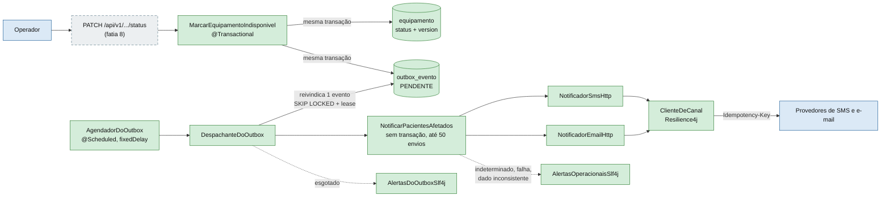
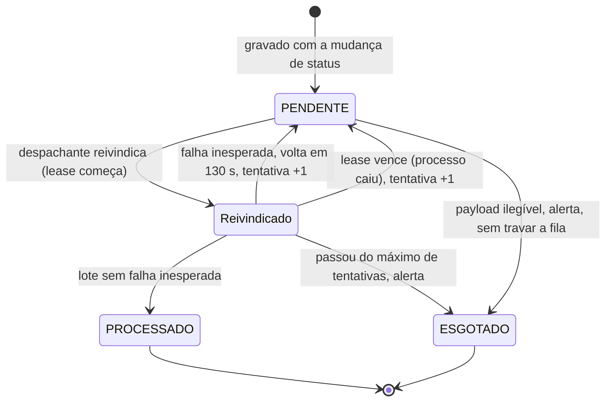
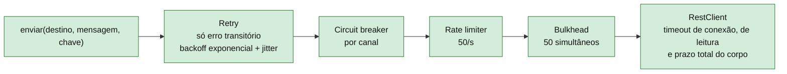

# Canais, outbox e despachante

Como um evento de equipamento indisponível sai do banco e chega ao paciente. Tudo aqui está **feito e commitado** (fatias 6, 6b, 7b e 7c, até o commit `ead4792`), exceto o endpoint `PATCH`, que é da fatia 8.

## 1. Visão de conjunto

O `PATCH` (planejado) chama o caso de uso de status. O evento vai para o outbox **na mesma transação** da mudança de status, e um agendador o despacha depois, fora dessa transação.



**Por que outbox:** se o evento fosse publicado depois do commit, uma queda entre os dois perderia o aviso. Gravado na mesma transação, ele só existe se o status mudou, e só some do outbox quando o lote termina.

## 2. Ciclo de vida de um evento no outbox



"Reivindicado" não é uma coluna: é um evento `PENDENTE` com `reivindicado_ate` no futuro. A tabela guarda `situacao`, `reivindicado_ate`, `tentativas` e `tipo_ultimo_erro`.

## 3. Uma rodada do despachante

```mermaid
sequenceDiagram
  autonumber
  participant Ag as AgendadorDoOutbox
  participant De as DespachanteDoOutbox
  participant Fi as Fila (outbox_evento)
  participant Lo as NotificarPacientesAfetados

  Ag->>De: despachar()
  loop até o tamanho do lote ou a fila esvaziar
    De->>Fi: reivindicar 1 evento (CTE MATERIALIZED, FOR UPDATE SKIP LOCKED)
    Note over De,Fi: transação curta; o lease vale só para este evento
    alt fila vazia
      Fi-->>De: nada
    else evento legível
      Fi-->>De: evento + tentativas
      De->>Lo: executar(evento), fora de transação
      alt lote sem falha inesperada
        De->>Fi: marcar PROCESSADO (só se ainda tem o lease)
      else falha ou exceção
        De->>Fi: devolver com atraso de 130 s, ou esgotar e alertar
      end
    else payload ilegível
      Fi-->>De: esgotado na mesma transação
      De->>De: alerta PayloadIlegivel e segue
    end
  end
  De-->>Ag: resumo (ou relança o primeiro erro de evento)
  Note over Ag: captura o erro, loga só a classe e roda de novo no próximo intervalo
```

Pontos que o diagrama mostra de propósito:

- **Um evento por vez:** o lease começa quando o evento passa a rodar. Reivindicar o lote inteiro de uma vez faria o lease do último vencer enquanto os primeiros rodam.
- **`SKIP LOCKED` com CTE `MATERIALIZED`:** dois despachantes (ou duas instâncias) nunca pegam o mesmo evento, e o planejador do Postgres não reavalia a subconsulta.
- **Escritas condicionais:** marcar, devolver e esgotar só valem se a tentativa ainda é a mesma. Quem perdeu o lease não conta nem alerta.
- **Atraso de 130 s maior que a reserva de 120 s:** quando o evento volta, as reservas abandonadas já venceram e são reassumidas. A aplicação não sobe se essa relação for violada.

## 4. Cadeia de resiliência de um canal



Resilience4j programático (`Decorators`, sem anotações). O retry fica por fora: cada tentativa passa de novo por breaker, limitador e bulkhead.

### Da resposta HTTP ao resultado

| Resposta do provedor | Retry? | Conta no breaker? | Resultado |
|---|---|---|---|
| `202` com `id` e situação aceita | não | não (sucesso) | `Confirmado` |
| Outro `2xx`, `3xx`, corpo ilegível ou fora do contrato | não | **sim** | `Indeterminado` |
| Corpo que não chega no prazo ou passa de 8 KiB | não | **sim** | `Indeterminado` |
| `5xx`, timeout, conexão derrubada | sim | sim | `Esgotado` se esgotar |
| `429` com `Retry-After` até 5 s | sim, esperando o pedido | sim | `Esgotado` se esgotar |
| `429` com `Retry-After` acima de 5 s, em data HTTP ou com 10+ dígitos | não | sim | `Esgotado` |
| `401` e `403` | não | **sim** (afeta todos os pacientes) | `Esgotado` |
| Outros `4xx` | não | **não** (afeta um paciente só) | `Esgotado` |
| Breaker aberto, limitador ou bulkhead negando | não | não | `Esgotado`, sem chamar o provedor |
| Exceção inesperada no adapter | não | sim | `Esgotado` |

`Esgotado` leva o caso de uso ao próximo canal (SMS, depois e-mail, depois revisão manual). `Indeterminado` encerra a cadeia: a mensagem pode ter sido aceita, então o aviso fica `PENDENTE` e gera alerta, e nunca vira `CONFIRMADO`.

### Chave de idempotência até o provedor

Cada aviso leva o cabeçalho `Idempotency-Key: <eventoId>:<agendamentoId>:<canal>`. O valor é calculado uma vez, fora do `Supplier` que o retry repete, então todas as tentativas e a reassunção da reserva enviam a mesma chave. O sufixo do canal separa o SMS do e-mail do fallback. A chave tem só ids.

## 5. Configuração (valores padrão)

| Propriedade | Valor | Para quê |
|---|---|---|
| `upa.aviso.tempo-limite-reserva` | 120 s | Reserva `PENDENTE` mais velha que isso é reassumida |
| `upa.aviso.concorrencia-maxima` | 50 | Envios simultâneos do lote |
| `upa.outbox.tamanho-do-lote` | 10 | Eventos por rodada |
| `upa.outbox.lease` | 10 min | Tempo de posse de um evento (a calibrar no k6) |
| `upa.outbox.atraso-de-reentrega` | 130 s | Espera antes de reprocessar um evento que falhou |
| `upa.outbox.maximo-de-tentativas` | 5 | Depois disso o evento é esgotado com alerta |
| `upa.outbox.intervalo` | 2 s | Pausa entre rodadas do agendador |
| `upa.outbox.habilitado` | `true` | Desligado nos testes de integração |
| `upa.canais.*` | ver spec §10 | Timeouts, retry, breaker, limitador e bulkhead por canal |

URL base e token de cada canal vêm só de variável de ambiente, sem valor padrão.

## O que foi conferido no código para desenhar

- `application/DespachanteDoOutbox.java` (um evento por vez, desfechos `PROCESSADO`, `DEVOLVIDO`, `ESGOTADO`, `LEASE_PERDIDO`).
- `infrastructure/persistence/OutboxRepositoryAdapter.java` (CTE `MATERIALIZED` com `FOR UPDATE SKIP LOCKED`, escritas condicionais por `tentativas`).
- `db/migration/V3__upa_equipamento_e_outbox.sql` (colunas e `CHECK` do `outbox_evento`).
- `infrastructure/canais/ClienteDeCanal.java` (ordem dos decoradores, classificação das respostas, cabeçalho `Idempotency-Key`).
- `infrastructure/config/OutboxConfiguration.java`, `AgendadorDoOutbox.java` e `application.properties` (valores padrão e validação cruzada).
