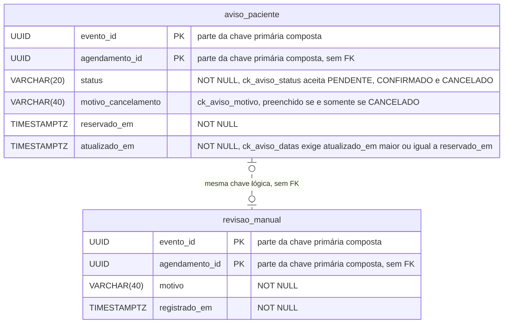

# Modelo ER: tabelas existentes

Migration `V1__aviso_paciente_e_revisao_manual.sql` (Flyway). **Existe no código e passa nos testes com Postgres 16 real** (fatia 4, commit `739a24e`). A tabela `flyway_schema_history` é criada pelo próprio Flyway e não aparece no desenho.

## Constraints, uma a uma

| Tabela | Constraint | O que garante |
|---|---|---|
| `aviso_paciente` | `PRIMARY KEY (evento_id, agendamento_id)` | **Um só aviso por evento e agendamento.** É a base da idempotência: `INSERT ... ON CONFLICT DO NOTHING` devolve 1 só para a execução vencedora |
| `aviso_paciente` | `ck_aviso_status` | Só `PENDENTE`, `CONFIRMADO` ou `CANCELADO` |
| `aviso_paciente` | `ck_aviso_motivo` | `(status = 'CANCELADO') = (motivo_cancelamento IS NOT NULL)`: motivo só no cancelamento |
| `aviso_paciente` | `ck_aviso_datas` | `atualizado_em >= reservado_em` |
| `revisao_manual` | `PRIMARY KEY (evento_id, agendamento_id)` | Revisão manual idempotente: reentregar o evento não duplica a linha |

## Decisões de modelagem

- **Sem chave estrangeira** para o agendamento: estas tabelas são dados do contexto de notificações e guardam `agendamento_id` só como id. Entre contextos, a regra do projeto é nunca fazer join em tabela alheia.
- **A chave primária composta atende a busca em lote por `evento_id`** (coluna líder), então não há índice extra. O adapter lê todos os avisos de um evento numa só consulta.
- **`TIMESTAMPTZ` e microssegundos:** o Postgres guarda microssegundos e o `Instant` do Java tem nanossegundos. O adapter trunca na escrita, e há teste para isso.
- **Os `CHECK` valem para quem escreve direto no banco**, não só para a aplicação. O `MigrationTest` prova isso.

## Tabelas planejadas (não existem ainda)

`upa`, `equipamento` (com `@Version`, lock otimista), `paciente`, `agendamento_exame` (índice por equipamento e data do exame) e `outbox_evento`. Entram nas fatias 5 e 7, quando um caso de uso precisar delas.

## O que foi conferido no código para desenhar

- Colunas, tipos e constraints: leitura direta de `src/main/resources/db/migration/V1__aviso_paciente_e_revisao_manual.sql`.
- Mapeamento nas entidades: `infrastructure/persistence/AvisoPacienteJpa.java` e `RevisaoManualJpa.java`.
- Constraints exercitadas: `src/test/.../infrastructure/persistence/MigrationTest.java`.
