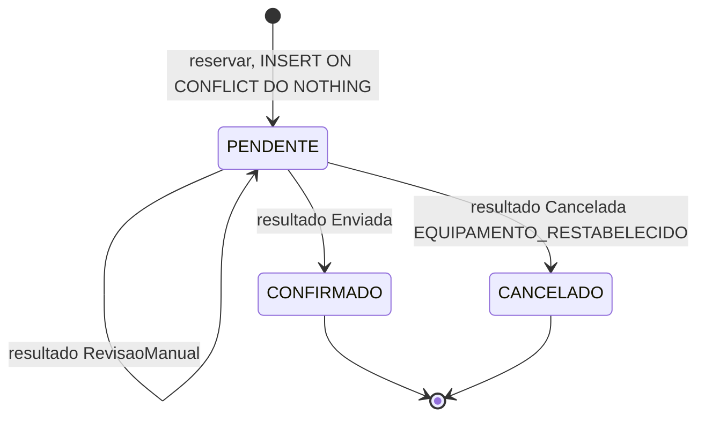
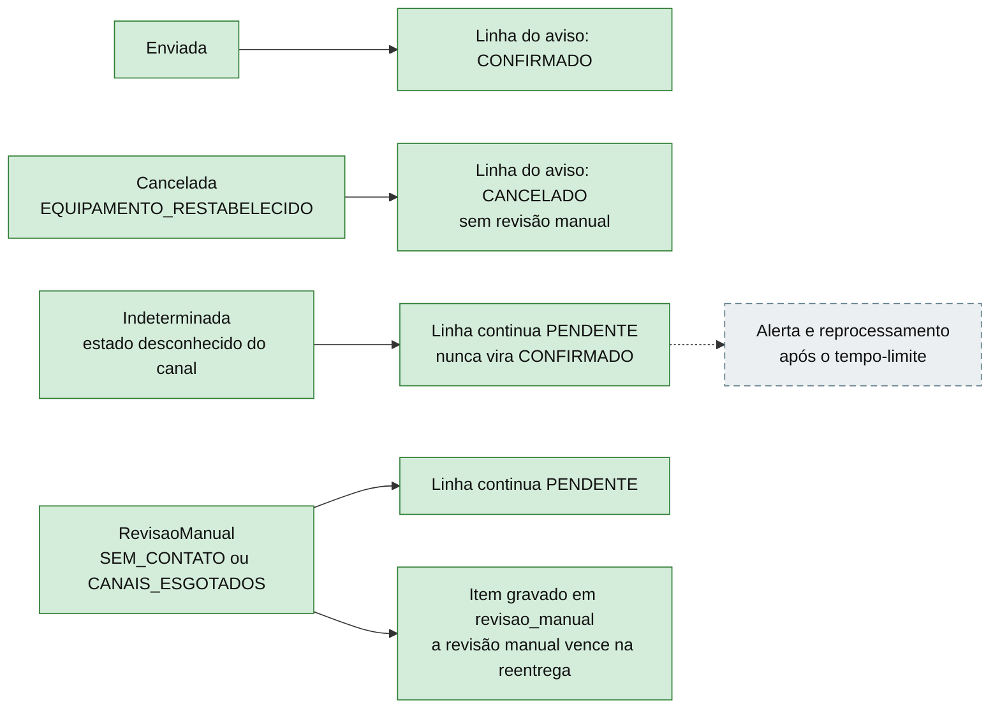
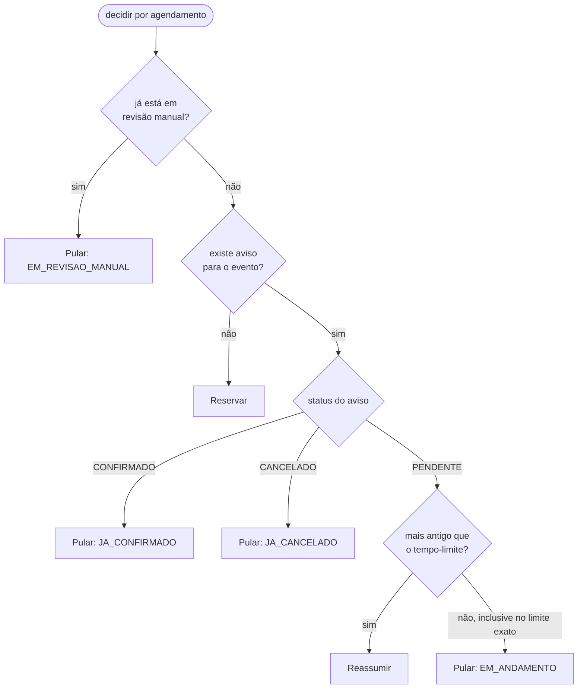
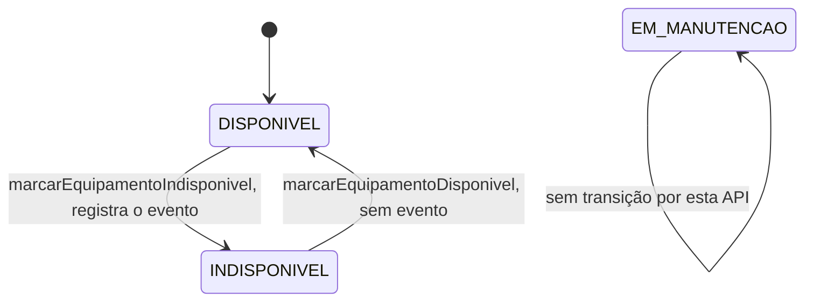

# Estados do aviso e dos resultados

Tudo aqui é **domínio já feito e commitado** (fatias 1b e 3), e a persistência dos estados no banco também (fatia 4, commit `739a24e`). O que ainda é planejado é o alerta de `Indeterminada` (camada de aplicação).

## 1. Estados da linha do aviso (`StatusAviso`)

Só `PENDENTE` evolui; `CONFIRMADO` e `CANCELADO` são terminais.

`CONFIRMADO` só acontece com a confirmação do canal. Na dúvida, o aviso fica `PENDENTE`.

## 2. O que cada resultado de uma tentativa (`ResultadoNotificacao`) provoca

`ResultadoNotificacao` é uma `sealed interface`; o código usa `switch` **sem `default`**, então um novo subtipo quebra a compilação até ser tratado.

## 3. Decisão por agendamento (`PoliticaDeReserva`)

A ordem das regras importa: a **revisão manual é consultada primeiro**.

O valor do tempo-limite ainda está **em aberto** (depende de tentativas, backoff e timeout). A política só recebe a `Duration` como parâmetro, estritamente positiva.

## 4. Estados do equipamento (`StatusEquipamento`)

Só `DISPONIVEL` e `INDISPONIVEL` se alternam. Repetir o mesmo status é inválido. `EM_MANUTENCAO` está fora do fluxo desta spec.

## O que foi conferido no código para desenhar

- Transições do aviso e efeito de cada resultado: `domain/StatusAviso.java` e `domain/AvisoPaciente.java` (métodos `aplicar`, `estaAbandonada` e `reassumir`).
- Subtipos dos resultados e motivos: `domain/ResultadoNotificacao.java`, `MotivoCancelamento.java`, `MotivoRevisaoManual.java`.
- Ordem das regras: `domain/PoliticaDeReserva.java` e `MotivoDoPulo.java`.
- Transições do equipamento: `domain/StatusEquipamento.java` (tabela com `switch` sem `default`).
