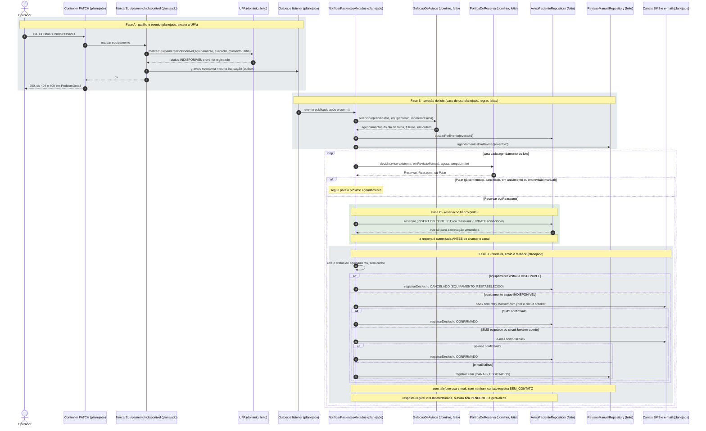

# Sequência: do PATCH do operador ao aviso ao paciente

Este é o fluxo **completo previsto pela spec 001**. Só alguns participantes existem hoje. Cada participante diz no nome se está **feito** (e commitado) ou **planejado**; as fases abaixo dizem o mesmo.

- Feitos e commitados: `UPA`, `SelecaoDeAvisos`, `PoliticaDeReserva` (domínio).
- Feitos (fatia 4, commit `739a24e`): as portas e os adapters de `aviso_paciente` e `revisao_manual`.
- Planejados: controller, casos de uso, outbox, listener, repositório de UPA e agendamento, adapters de SMS e e-mail.

## Pontos que o diagrama mostra de propósito

- **Reserva antes do envio, commitada antes do canal:** é o que impede duas execuções de enviar para o mesmo paciente, e nenhuma transação fica aberta durante a chamada HTTP.
- **Quem decide o vencedor é o banco:** `reservar` e `reassumir` devolvem `true` só para uma execução, mesmo com disputa simultânea.
- **Revisão manual não muda a linha do aviso:** o aviso continua `PENDENTE` e a revisão manual vence na reentrega do evento.
- **`Indeterminada` nunca conta como notificado:** na dúvida, não se marca `CONFIRMADO`.

## O que foi conferido no código para desenhar

- Seleção, ordem, dia da falha e horário futuro: `domain/SelecaoDeAvisos.java`.
- Ordem das regras de pular, reservar e reassumir: `domain/PoliticaDeReserva.java` e `domain/DecisaoParaAgendamento.java`.
- Efeito de cada resultado no aviso: `domain/AvisoPaciente.aplicar` e `domain/ResultadoNotificacao.java`.
- Operações condicionais no banco: `infrastructure/persistence/AvisoPacienteJpaRepository.java` e a Javadoc de `application/AvisoPacienteRepository.java`.
- Parte planejada: spec 001, §5 (fluxo), §6 (casos "E se...") e §10 (resiliência).
